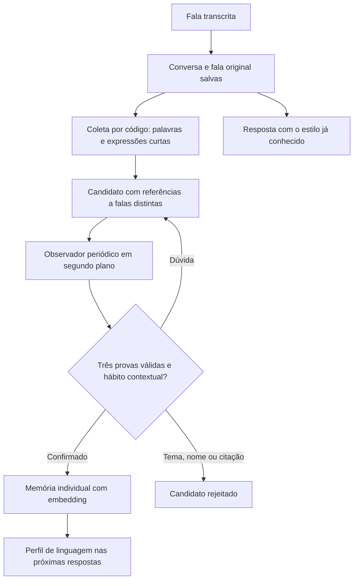

# Aprender expressões repetidas em conversas distantes

Antes, o observador via apenas seis falas recentes. Uma expressão usada hoje,
semana que vem e depois disso podia nunca reunir três evidências nessa janela.
Agora os exemplos candidatos permanecem no Supabase entre visitas.

## O caminho da informação

A coleta inicial não usa IA: separa sequências de uma a três palavras, sem assumir
que são gírias. A IA decide depois se a repetição representa um hábito de linguagem
ou apenas um assunto. Por isso “futebol” não vira automaticamente estilo de fala.

## As duas tabelas novas

| Tabela | O que guarda |
| --- | --- |
| `talk_language_candidates` | Expressão normalizada, dono, estado, primeira/última ocorrência e vínculo com a memória quando confirmada. |
| `talk_language_evidence` | Referências a até seis falas originais por candidato. Cada fala só conta uma vez. |

As referências apontam para `talk_turns`; não há cópia da conversa inteira nessas
duas tabelas. Elas são restritas ao servidor: acesso público e de usuários pela
API está revogado, com RLS habilitado. As memórias confirmadas continuam em
`talk_memories`, com seus próprios embeddings.

## Exemplo: “tá ligado”

1. Na primeira fala, a expressão vira candidata com uma referência.
2. Muitas mensagens depois, uma segunda fala aumenta sua evidência.
3. Outra ocorrência reúne três falas distintas, mesmo fora da janela recente.
4. Numa rodada elegível, a IA recebe esses exemplos e avalia o contexto de uso.
5. O código e o banco validam as origens e os trechos. Se aprovado, o padrão é
   salvo como memória individual e o candidato fica marcado como confirmado.

Para um padrão observado com referência a um candidato conhecido, o servidor
seleciona três trechos literais das falas originais, incluindo a atual. A descrição
proposta precisa mencionar a expressão; referências desconhecidas, menos de três
falas distintas ou trechos sem a expressão não são reparados. A seleção não
inventa evidência e ainda passa pelos validadores do aplicativo e do banco.
Isso evita depender de a IA copiar sem erro os trechos fornecidos. A IA continua
decidindo se o candidato representa um hábito e em que contexto é usado.
Padrões gerais sem candidato conhecido continuam exigindo exemplos da proposta.
Se o identificador proposto não respeitar o formato, o servidor gera uma chave
estável a partir da referência verificada do candidato. Identificadores já válidos
são preservados. Essa correção não altera a descrição do hábito e não permite
salvar uma observação sem três fontes distintas.

Três ocorrências permitem avaliar; não garantem aprovação imediata. Se forem
citações, nomes ou um assunto repetido, podem ser rejeitadas. Dúvidas permanecem
pendentes. Preferência explicitamente declarada segue dispensando três repetições.

Os padrões confirmados não somem só porque passaram seis falas sem a expressão.
Eles entram no perfil das respostas futuras; o personagem usa a gíria quando
combina com o contexto, sem obrigação de colocá-la em toda frase.

## Limites e efeito na conversa

- Até 96 candidatos considerados por fala, priorizando expressões já existentes.
- Até 500 candidatos armazenados por usuário e seis referências por candidato.
- Até doze candidatos elegíveis enviados por análise, com até três padrões propostos.
- Evidências candidatas valem por 90 dias; candidatos pendentes sem ocorrência por
  90 dias são expirados na próxima coleta. Ao atingir o teto, entradas fracas ou
  rejeitadas antigas podem ser reutilizadas. As falas originais não são apagadas.
- A migração examina até cinquenta falas anteriores por usuário para iniciar a
  coleta. Isso não confirma hábitos automaticamente nem importa dados fictícios.

A coleta é um gatilho na mesma transação que salva a fala: não faz uma chamada
extra à OpenAI, mas acrescenta trabalho no banco e pode aumentar um pouco a
gravação. A análise de IA continua em segundo plano, com uma tarefa por usuário
local e a pendência mais recente. Já havendo padrões, mantém a cadência de três
turnos; antes disso, tenta nos turnos elegíveis após as três primeiras falas.

Reiniciar o servidor perde a tarefa ativa e a pendência em RAM, mas preserva
candidatos, referências, histórico e padrões salvos no banco. Uma nova fala
elegível pode retomar a análise. Resultados atrasados não sobrescrevem correções
ou a versão atual da conversa. Recusa explícita do aprendizado de expressões
interrompe a coleta e impede fornecer candidatos nessa categoria.

## Estudo de uma hora

1. **15 minutos:** leia este fluxo e compare candidato, evidência e memória.
2. **15 minutos:** `supabase/migrations/20261010212151_persistent_language_candidates.sql`
   — tabelas, gatilho, limites e promoção.
3. **15 minutos:** `apps/server/src/language.ts` e `voice.ts` — trechos literais,
   análise contextual e identificação das falas de origem.
4. **15 minutos:** `apps/server/src/language-worker.ts`, `memory.ts` e
   `docs/diagnostico-memoria.md` — segundo plano, gravação e diagnóstico.

## Validação e reversão

`db/verify-language-candidates.sql` exercita falas espaçadas, evidências somente
do usuário, idempotência, origem, promoção, recusas, limite e compatibilidade com
a conversa existente. Execute junto da migração numa transação que termina em
`ROLLBACK`; os exemplos sintéticos não devem permanecer no perfil real.

`db/rollback-language-candidates.sql` desativa a coleta e os RPCs novos após voltar
o aplicativo à versão anterior. Ele preserva as tabelas e o histórico para permitir
recuperação; não apaga as memórias existentes.
